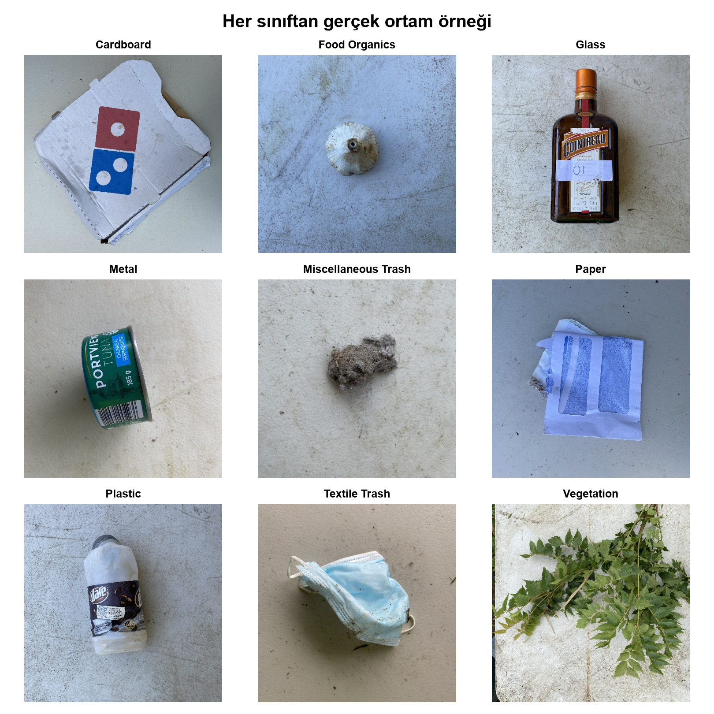
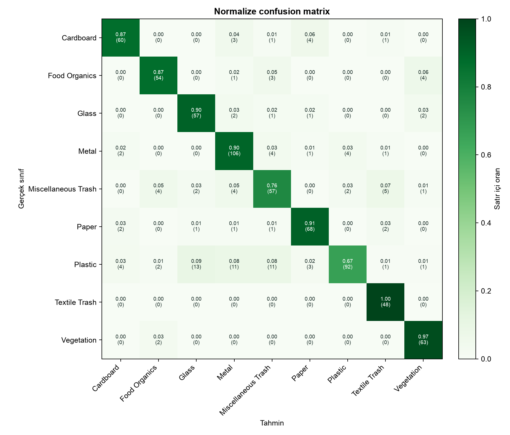
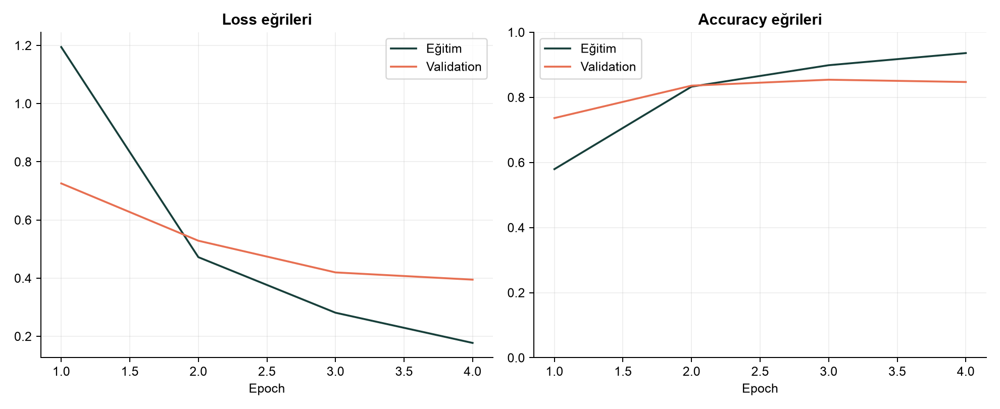

# Atığını Tanı - Gerçek Ortam Atık Sınıflandırması

<p align="center">
  <strong>RealWaste görüntülerini dokuz malzeme sınıfına ayıran, hata analizi ve kullanıcı arayüzü içeren uçtan uca derin öğrenme projesi.</strong>
</p>

<p align="center">
  <a href="https://colab.research.google.com/github/serratanis/atigini-tani-atik-siniflandirma/blob/main/notebooks/Atigini_Tani_RealWaste.ipynb"></a>
  
  
  
</p>

Atığını Tanı, gerçek bir depolama sahasında çekilmiş görüntüleri sınıflandırır. Çalışma yalnızca toplam doğruluğu değil; sınıf dengesi, macro precision-recall-F1, karışıklık matrisi ve yanlış tahmin örneklerini birlikte değerlendirir.

<p align="center">
  
</p>

## Doğrulanmış sonuçlar

- Test seti: **713 görüntü**
- Accuracy: **%84,85**
- Macro precision / recall / F1: **%84,78 / %87,18 / %85,54**
- Top-2 accuracy: **%94,39**
- Çoğunluk sınıfı baseline: **%19,38**
- Model: **2.235.401 parametreli MobileNetV2**

<p align="center">
  
  
</p>

## Problem ve veri

Girdi tek bir RGB atık görüntüsüdür. Model; `Cardboard`, `Food Organics`, `Glass`, `Metal`, `Miscellaneous Trash`, `Paper`, `Plastic`, `Textile Trash` veya `Vegetation` sınıfını tahmin eder.

- Veri seti: [UCI RealWaste](https://archive.ics.uci.edu/dataset/908/realwaste)
- DOI: [10.24432/C5SS4G](https://doi.org/10.24432/C5SS4G)
- Boyut: **4.752 görüntü, 9 sınıf, 524 × 524 piksel**
- Ortam: gerçek depolama sahası
- Lisans yaklaşımı: daha kısıtlayıcı **CC BY-NC-SA 4.0** koşulları esas alınır

## Yöntem

- Stratified %70 eğitim, %15 validation ve %15 test ayrımı
- SHA-256 ile tam kopya denetimi
- Yalnız eğitim verisine veri artırımı
- Sınıf ağırlıklı cross-entropy
- ImageNet ön eğitimli MobileNetV2 ile transfer learning
- AdamW, validation loss takibi ve early stopping
- Accuracy, macro/weighted precision-recall-F1, top-2 accuracy ve hata analizi

## Uygulamayı açma

Mac'te `UYGULAMAYI-BASLAT.command` dosyasına çift tıklayın. Terminalden çalıştırmak için:

```bash
python3 -m venv .venv
source .venv/bin/activate
pip install -r requirements.txt
streamlit run app.py
```

Modeli yeniden eğitmek için veri setini indirip aşağıdaki komutu çalıştırın:

```bash
bash scripts/download_data.sh
python src/train_model.py --data-dir data/raw/realwaste-main/RealWaste
```

## Proje çıktıları

- [Google Colab çalışma defteri](https://colab.research.google.com/github/serratanis/atigini-tani-atik-siniflandirma/blob/main/notebooks/Atigini_Tani_RealWaste.ipynb)
- `deliverables/Atigini-Tani-Proje-Raporu-Gelistirilmis-v3.pdf`: 5 sayfalık final raporu
- `models/atigini-tani-mobilenetv2.pt`: eğitilmiş model
- `results/metrics.json`: sınıf bazlı metrikler
- `results/test_predictions.csv`: satır düzeyinde test tahminleri

## Sınırlar

Bu model bir eğitim projesidir. Farklı kamera, ışık, coğrafya veya belediye ayrıştırma kurallarında performans düşebilir. Tahminler yerel atık mevzuatının veya insan denetiminin yerine geçmez.
